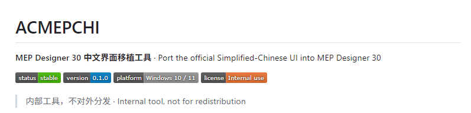
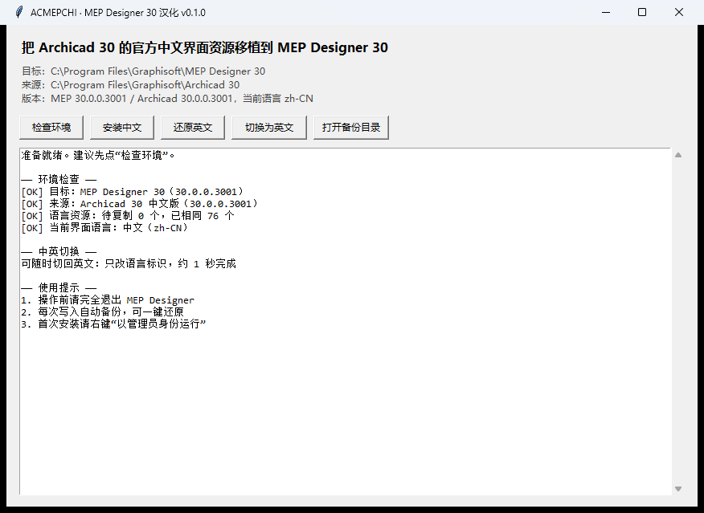
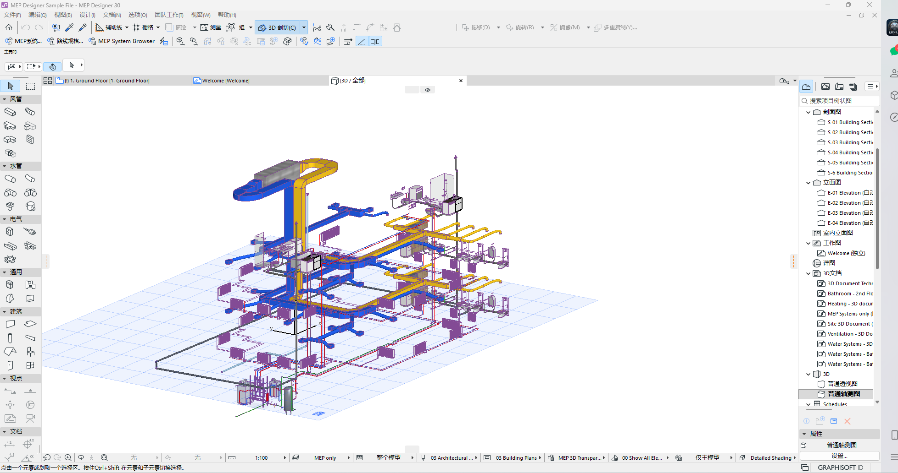
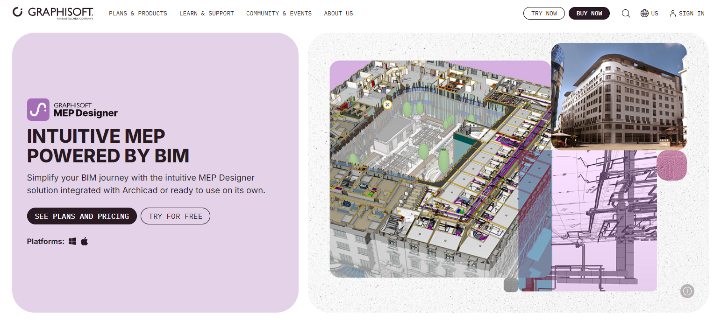

# 三维虚拟建造（VDC），MEP机电与你同行

> 把官方中文界面“搬”进 MEP Designer 30——一个内部汉化工具的使用手记

2026 年 11 月 · 内部技术分享

在三维虚拟建造（VDC，Virtual Design and Construction）里，模型是共同语言，软件是工具。而界面语言，往往决定了团队能不能把注意力放在管线上，而不是放在猜菜单上。

## 一、一条管线背后的语言成本

MEP 设计的工作流并不复杂：建模、避让、算量、出图、交底。但当天花板下的风管、水管、桥架越来越密，团队之间的沟通就会变多——设计师看模型，施工方看剖面，运维方看属性。这个时候，如果软件界面是英文的，每一次交底都要多一句解释：“这个 Duct Route，就是风管路线。”

MEP Designer 的独立版只提供英文界面，而它和 Archicad 同源。好消息是：Archicad 30 中文版里，本来就带着一整套官方的简体中文界面资源。我们做的，只是把这套资源搬到 MEP Designer 里，让工具说中文。

## 二、我们做了什么：只搬运，不翻译

这个内部工具叫 **ACMEPCHI**，原则只有三条：不翻译、不反编译、不改程序本体。界面上的中文，全部来自本机已安装的 Archicad 30 中文版。

| 界面位置 | 内容 |
|---|---|
| 对话框、控件、提示 | 对话框、控件、提示文本 |
| 工具与菜单 | 工具名、菜单项、对话框与告警文案 |
| 工作环境 | 菜单标题、工具面板分组名（风管 / 水管 / 电气…） |

三类文本分别存放在界面卫星文件、程序内的字符串表和用户工作环境配置里。工具会逐类处理，每次写入前自动备份，随时可以还原。

> 我们不改一行程序逻辑，只把厂商已经做好的中文，放到它该在的位置。

## 三、三步，把界面变成中文

工具只有一个窗口，双击即用。打开后它会自动识别 MEP Designer 与 Archicad 的安装位置、构建号和当前语言。

1. **检查环境**——确认目标与来源版本一致，统计需要迁移的资源数量。
2. **安装中文**——先完整备份，再写入界面资源；全程不需要联网。
3. **重启 MEP Designer**——重新打开后，菜单、工具面板和对话框即为中文。

> **小提示：** 写入 Program Files 需要管理员权限，首次使用请右键选择“以管理员身份运行”；操作前请完全退出 MEP Designer。

## 四、中英文随时切换，大约一秒

汉化不应该是单向的。有时需要对照英文教程，有时要和海外同事共享屏幕，界面能随时切回英文就很重要。

新版工具把这件事做轻了：英文资源始终保持原样，中文资源单独存放。切换时只改一个语言标识，并互换几个工作环境文件，不必重新复制整套资源，也不重建词库——通常在 1 秒内完成。

- 图形界面点“切换为英文 / 切换为中文”即可；
- 命令行执行 `python -m acme_lp.cli lang` 也能互切；
- 每次切换仍要求先退出 MEP Designer，避免文件被占用。

## 五、效果：从菜单到属性，一整套中文

下面这张是汉化后的实际界面。左侧工具面板按“风管、水管、电气、通用、建筑、视点、文档”分类，顶部菜单与右侧属性面板也全部是中文；模型里的风管、水管与电气桥架，仍然保持原有的图层与分类。

对刚接触机电 BIM 的同事来说，这一步省掉的不只是查词典的时间，更是“这个按钮到底该不该点”的犹豫。工具名和菜单变成母语之后，培训可以从“认界面”直接进入“讲逻辑”。

## 六、放回 VDC 的流程里看

MEP Designer 与 Archicad 同源，模型可以在建筑与机电之间顺畅衔接。当界面语言不再是障碍，机电专业就能更早进入三维虚拟建造的协作节奏：在模型里发现碰撞，在模型里确定标高，在模型里完成交底。

软件只是入口，真正产生价值的是流程：建筑、结构、机电在同一个模型里对话，问题在屏幕上解决，而不是留到工地上。界面说中文，只是让更多人能走进这间“虚拟建造”的会议室。

## 七、使用边界

- 需要本机同时安装 **MEP Designer 30** 与**同构建的 Archicad 30 中文版**，中文资源由后者提供。
- 工具只适用于 MEP Designer 30（build 3001），升级软件后资源版本会变化，需要重新执行一次安装。
- 每次写入都会备份到本地，可一键还原；但请勿删除工作环境中的标准命令文件，否则“设计”菜单会消失。
- 内部使用，请勿对外分发移植后的资源包，并遵守 Graphisoft 的许可条款。

## 八、结语

三维虚拟建造不是一句口号，它由很多具体的小事组成：一条风管的避让、一次剖面的确认、一位新同事第一次独立完成建模。界面语言是其中很小的一件，却常常是挡在门口的那一级台阶。

把台阶拿掉，MEP 机电就能更自然地与你同行。

---

**工具：** ACMEPCHI · MEP Designer 30 中文界面移植工具（内部使用）
版本 0.1.0 · 支持图形界面与命令行 · 中英一键切换

### 项目仓库 · Repositories

- GitHub：<https://github.com/archilau0315/acmepchi>
- Gitee：<https://gitee.com/archilau/acmepchi>
- 下载：[ACMEPCHI-30.exe（v0.1.0）](https://github.com/archilau0315/acmepchi/releases/download/v0.1.0/ACMEPCHI-30.exe)

以上仓库均为公开仓库，无需授权即可访问。
